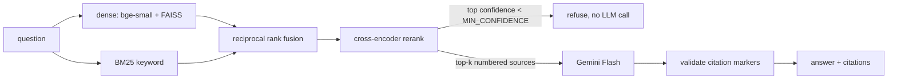

# CloudSherpa

A customer-facing, multi-agent **Google Cloud solution-architect assistant**. You describe a
workload in chat. CloudSherpa asks discovery questions and grounds its answers in Google Cloud
documentation with citations. It also analyzes billing data for waste, then returns a
recommended architecture, a cost estimate, optimization findings and a Terraform starter.

Built with Gemini (Developer API or Vertex AI), hybrid RAG and the Google Agent Development
Kit, with an evaluation harness.

> **Status: phase 1 of 7.** The scaffold, configuration, corpus ingestion and the baseline
> hybrid RAG with citations are done. The other parts are not built yet; see the
> [roadmap](#roadmap).

## Quickstart

```bash
make install                 # venv + deps (Python 3.11)
cp .env.example .env         # add GEMINI_API_KEY (or Vertex AI settings)
make index                   # chunk + embed the committed corpus (local model, no key)
python scripts/ask.py --retrieve-only "How much notice does a Spot VM get?"   # no key needed
make ask Q="When should I choose Spanner over Cloud SQL?"                       # needs a key
make test                    # unit tests, no network or key
make eval-smoke              # 5-scenario eval with a mocked model (what CI runs)
```

No `make` on Windows? Each target is a plain `python …` command, listed in the `Makefile` and in
[evals/README.md](evals/README.md).

`make index` downloads two small ONNX models on first run (bge-small embeddings and the
MiniLM cross-encoder, about 150 MB in total). The docs corpus is already in
`data/corpus/`. `make ingest` re-fetches it.

## How retrieval works (phase 1)



- **Corpus.** The corpus is 65 Google Cloud documentation pages listed in `rag/sources.yaml`. They cover compute,
  databases, storage, networking, security, cost, the Well-Architected Framework and Vertex AI.
  Each page is extracted to Markdown with its source URL in front matter (CC BY 4.0, see
  `data/corpus/NOTICE.md`).
- **Hybrid retrieval.** Dense embeddings capture paraphrase ("cheap interruptible VMs"). BM25
  catches exact identifiers that embeddings blur (`n2-standard-4`, `CUD`, `RETRIEVAL_QUERY`).
  The two rankings are merged with reciprocal rank fusion, then a cross-encoder reranks the
  candidates.
- **Refusal path.** The reranker's sigmoid score is used as a relevance probability. If the best chunk
  scores below `MIN_CONFIDENCE`, the system refuses *before* calling the LLM. The model can
  also refuse (`INSUFFICIENT_CONTEXT`) when the sources don't cover the question.
- **Citations.** Sources are numbered `[S1]…[Sk]` in the prompt, and the answer must cite them inline.
  Markers that don't correspond to a provided source are stripped and recorded, so evals can
  count hallucinated citations.
- **Pluggable backends.** These are selected by environment variables. Defaults are local and work
  with no credentials.

  | Component | Default (local) | Managed option |
  |---|---|---|
  | Embeddings | fastembed `BAAI/bge-small-en-v1.5` | `EMBEDDING_PROVIDER=gemini` (`gemini-embedding-001`) |
  | Vector store | FAISS (exact inner product) | `VECTOR_STORE=vertex` (Vertex AI Vector Search) |
  | LLM | Gemini Developer API (`GEMINI_API_KEY`) | Vertex AI (`GOOGLE_GENAI_USE_VERTEXAI=true`) |

  The Vertex AI Vector Search backend is written against the documented
  `google-cloud-aiplatform` API (`pip install -e .[gcp]`). It is not exercised by the test
  suite, which needs no GCP project.

## Repository layout

```
core/        settings (pydantic-settings) and the Gemini client wrapper
rag/         ingestion, chunking, embeddings, vector stores, BM25, reranker, retriever, answerer
scripts/     ingest_corpus.py, build_index.py, ask.py
data/corpus/ committed docs snapshot (Markdown + front matter)
tests/       unit tests (offline) + integration tests over the real index
agents/ tools/ mcp_server/ api/ ui/ infra/ evals/   later phases
```

## Defaults chosen (and why)

- **Local embeddings and reranker by default.** Evals are reproducible, free and runnable
  without credentials. Gemini embeddings are one environment variable away.
- **FAISS flat index.** The corpus has a few thousand chunks, so exact search is fast, and
  approximate search would only add recall loss.
- **Fixed-size chunking as the baseline.** It is deliberately structure-blind, so later evals can
  measure whether heading-aware chunking (`CHUNKING_STRATEGY=markdown`, already implemented) helps.
- **Model IDs.** `gemini-3.8-flash` and `gemini-3.1-pro-preview` come from the Gemini models page
  as of October 2026; the 2.5 family is deprecated. Both are configurable (`FLASH_MODEL`, `PRO_MODEL`).
- **Committed corpus snapshot.** Live docs change, and eval numbers should be traceable to
  the exact text that was retrieved.

## Roadmap

| Phase | Scope | Status |
|---|---|---|
| 1 | Scaffold, config, corpus ingestion, baseline hybrid RAG with citations | ✅ done |
| 2 | Eval harness (50-scenario golden set, LLM-as-judge + deterministic metrics), baseline results | 🟡 harness + golden set done; baseline pending review and credentials |
| 3 | ADK multi-agent flow, cost tools + MCP server, architect output | ⏳ |
| 4 | Guardrails, observability, model routing | ⏳ |
| 5 | FastAPI + SSE, web chat UI | ⏳ |
| 6 | Docker, Terraform (Cloud Run), Cloud Build, `make deploy` | ⏳ |
| 7 | Eval-driven improvements, EVALS.md, README polish, DEMO.md | ⏳ |
